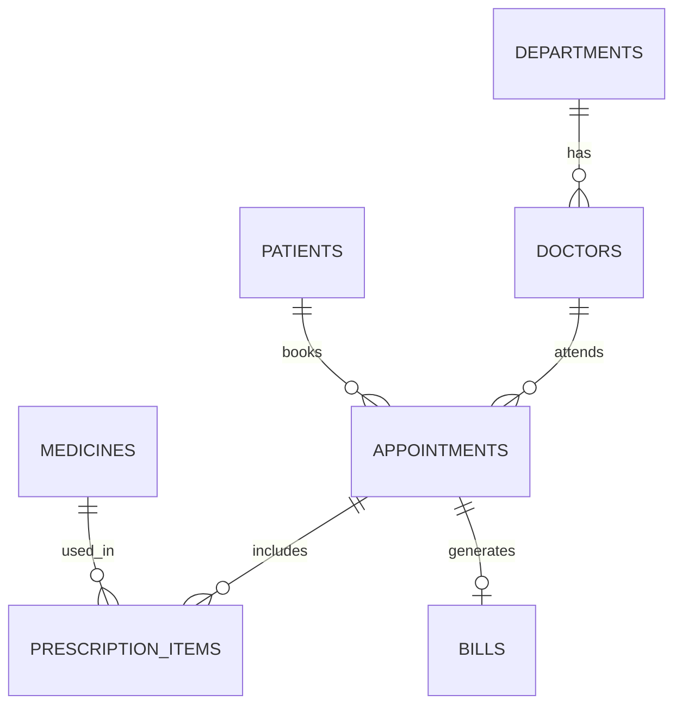

# Hospital Management System (DBMS Project)

A relational database for a hospital, built in MySQL. It manages departments, doctors, patients, appointments, prescriptions, medicine stock and billing.

All sample data is fictional.

## ER diagram



## DBMS concepts used

| Concept | Where |
| --- | --- |
| Normalization (3NF) | Patient, doctor and medicine details are stored once and linked by foreign keys |
| Many-to-many relationship | `prescription_items` connects appointments and medicines |
| Composite primary key | `prescription_items (appointment_id, medicine_id)` |
| One-to-one relationship | `bills.appointment_id` is unique, so an appointment has at most one bill |
| Constraints | `UNIQUE (doctor_id, appointment_time)` prevents double-booking; `CHECK` stops negative prices and stock |
| Generated column | `bills.total_amount` is calculated by the database |
| View | `appointment_details` shows readable names |
| Trigger | `trg_reduce_stock` checks and reduces medicine stock |
| Stored procedure | `generate_bill` creates a bill and rejects appointments that are not completed |
| Joins, subqueries, window functions | `sql/03_queries.sql` |

## Design decisions

- `consultation_amount` is copied onto the bill so that old bills stay correct if a doctor's fee changes later.
- `total_amount` is a generated column, so the total can never disagree with its parts.
- Medicine stock is reduced by a trigger, so it stays correct however the prescription is added.

## How to run

You need MySQL 8 or later. Run these from the project folder:

```
mysql -u root -p < sql/01_schema.sql
mysql -u root -p < sql/02_sample_data.sql
mysql -u root -p -t < sql/03_queries.sql
```

Running `01_schema.sql` again deletes and recreates `hospital_db`.
